---
title: Short-term Scientific Missions
description: STSMs completed within WIMANET
permalink: /stsms/
toc: true
---

## STSMs in 2025

### Regine Claire Tabe Tiku

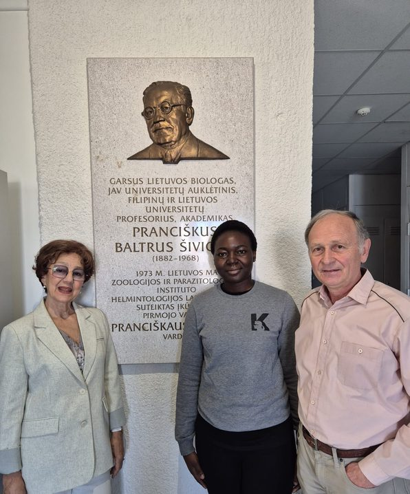
Regine Claire Tabe Tiku from Austria went to visit Dr. Gediminas Valkiūnas in Lithuania to trained in morphological differential diagnosis of malaria and related haemosporidian parasites of birds. 

Your training?

> "The training, spanning over four-weeks, was to refine her microscopy skills and study parasite morphology, with hands-on examination of blood smears and identification of avian blood parasite species from migratory birds, with attempts to link morpho species to PCR-confirmed genetic lineages and description of potentially novel and cryptic parasite species."
   

### Misa Shimizu

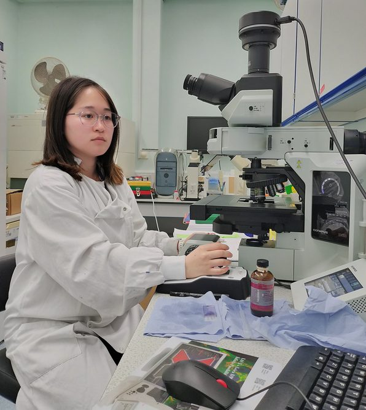
Misa Shimizu from Lithuania went to visit Dr. Jenny Dunn in the UK to conduct morphological and molecular analyses of samples and assess the immunological impact of Haemoproteus parasites on their avian hosts. 

Your workflow?

> "Workflow: Analysis of the vulture samples had to be conducted in the UK due to CITES restrictions and involved:  (a) Microscopy analysis with (i) morphological identification of Haemoproteus parasites, (ii) blood cell counts and (iii) cytometry to assess immunological responses; (b) molecular analysis in (i) optimizing PCR protocols and primer sets to improve DNA sequencing, (ii) re-testing archived samples to validate molecular identification methods and (iii) screening new samples; and phylogenetic analysis to classify parasite lineages."
   

### Jesús Veiga

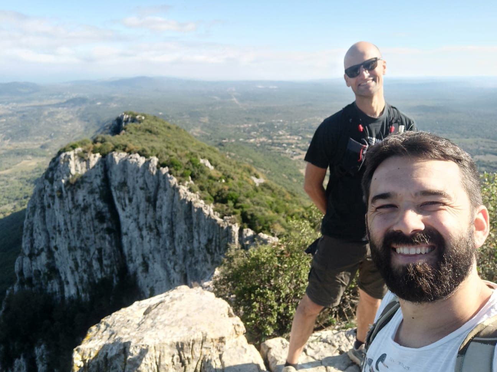
Jesús Veiga from Spain went to visit Dr. Serafín Gutiérrez in France to learn novel genomic molecular tools for pathogen screening in Culicoides vectors. 

Your aim?

> "The aim was to acquire bioinformatics skills necessary for identifying viruses in Culicoides using genomic information and a bioinformatic approach traditionally used at the host institution to detect viruses."
   

### Irene Hernández Caballero

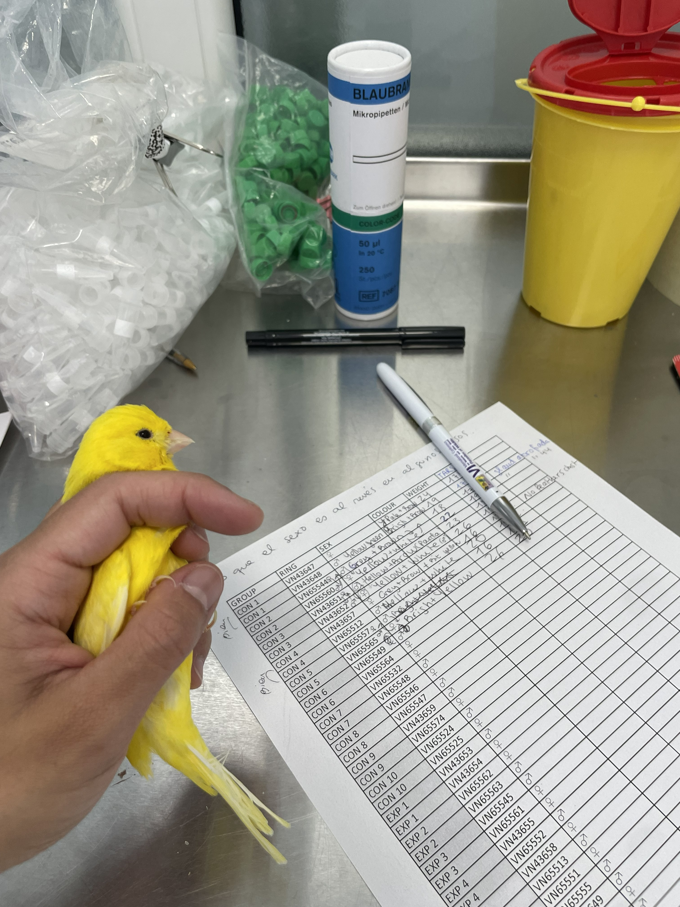
Irene Hernández Caballero from Spain went to visit Dr. Vaidas Palinauskas in Lithuania to work on the modulation of host gene expression and uropygial microbiome by *Plasmodium relictum*. 

Your main work?

> "The work involved a 49-days experiment, infecting canaries (*Serinus canaria domestica*) with *Plasmodium relictum* (lineage pSGS1), collecting blood samples for microscopy and molecular analyses, swab samples for microbiome analysis, and performing detailed microscopic evaluation of parasitemia."
   

### Gaia Porporato 

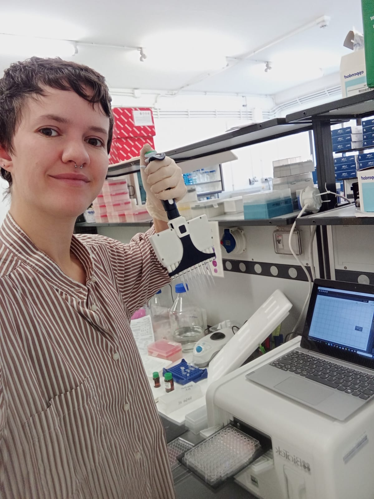
Gaia Porporato from Germany went to visit Prof. David Costantini in Italy to work on the oxidative stress as a direct response of Haemosporidian infection. 

Your experience?

> "Thanks  to the STSM that I carried out through WIMANET in the University of  Viterbo, I learned how to quantify oxidatory stress markers in blood samples. Joining their team expertise on oxidatory stress and immunology with our team expertise on blood parasites led to interesting insights of the physiology  associated with the host response to the parasite invasion."
   

### Claudio Navarrete 

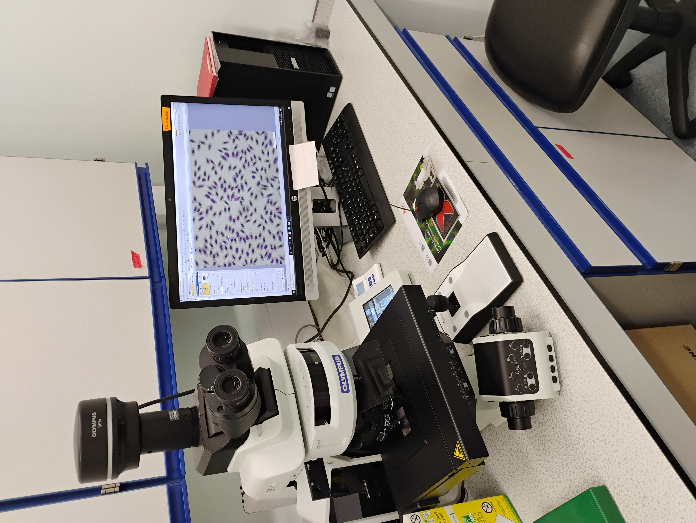
Claudio Navarrete from Lithuania went to visit Dr. Jenny Dunn in the UK to work on the spatial and temporal variation in Leucocytozoon infection across European Passer species. 

Your objectives?

> "The objectives of the STSM were to receive hands-on training in field sampling, molecular diagnostics, and microscopy for detecting Leucocytozoon parasites; to conduct fieldwork to capture birds and collect blood samples; and to perform laboratory analyses on archived and new samples."
   

## STSMs in 2024

### Margarita Kazak 

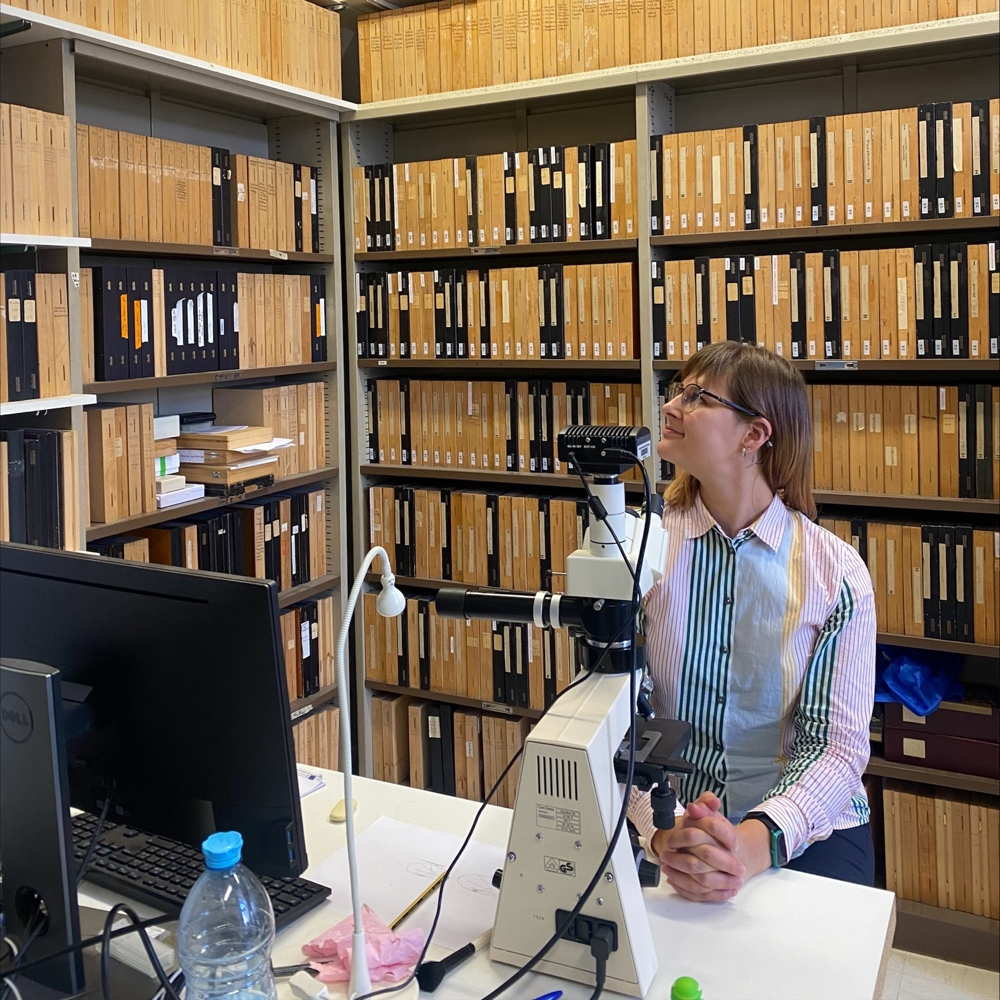
Margarita Kazak from Lithuania went to visit Dr. Bruno Mathieu in France to train on the taxonomy and systematics of Culicoides (Diptera: Ceratopogonidae) biting midges including training on morphological and molecular methods and to expand her knowledge on biting midge seasonal trapping method selection. 

Your expectations?

> "Because of this internship, I was able not only to deepen my knowledge, but also to learn new methods to prepare the material for morphological identification; I was able to discover a new species in Lithuania in the material I had brought with me to the STSM, I was able to work with the Culicoides fauna of Asia and to visit several French farms where we carried out trapping of biting midges. Moreover, I was invited by dr. Bruno Mathieu to go to trainings in Vietnam as an expert on Culicoides; the trip to Vietnam and experience overall opened new carrier opportunities for me and gave me valuable experience."
   

### Carolina Chagas 

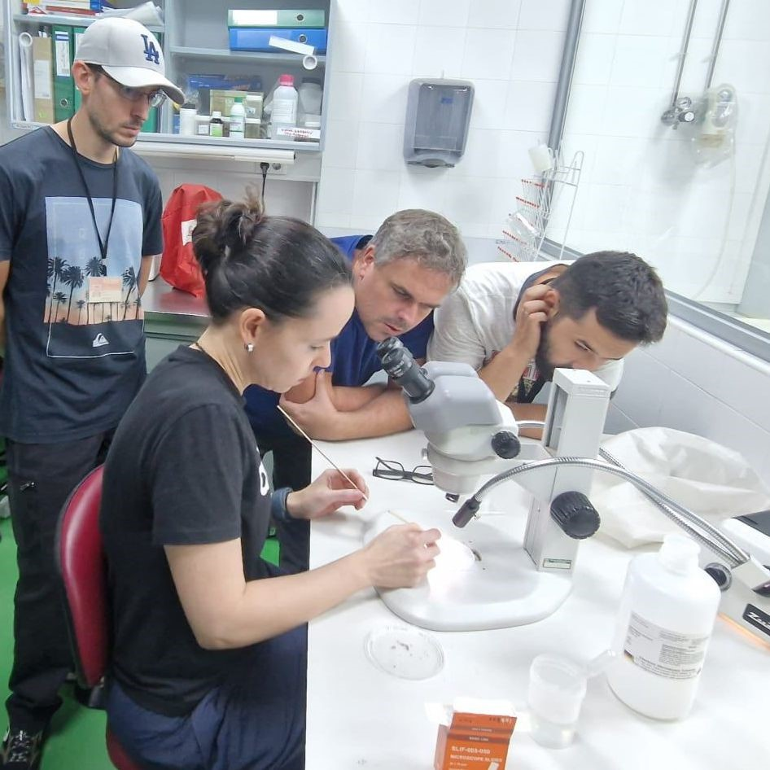
Carolina Chagas from Lithuania, went to visit Dr. Josue Martinew-de la Puente in Spain. She is co-leading the WG3 and wanted to discuss the next steps for it with Dr. Josue Martinez-de La Puente. During this visit they were able to start writing a review about the role of Culicoides in the transmission of Haemoproteus and Trypanosoma. This review is going to include several participants of the network and should be submitted soon. Additionally, they also discussed about the 2026 Summer School, to be focused on vectors and to be held in Spain. 

An anecdote?

> "The entire experience was great! I had the opportunity to interact more with such renowned researchers such as Dr. Josue Martinez-de La Puente, Dr. Martina Ferraguti and Dr. Jesus Veiga. It was also nice to see their research facilities and bring this knowledge back to my home institution. I also had the opportunity to meet Dr. Mikel Alexander González, which is an expert in Diptera insects. Everyone in the laboratory was very friendly and it is a place that I would love to come back!."
   

### Marta Garrigós 

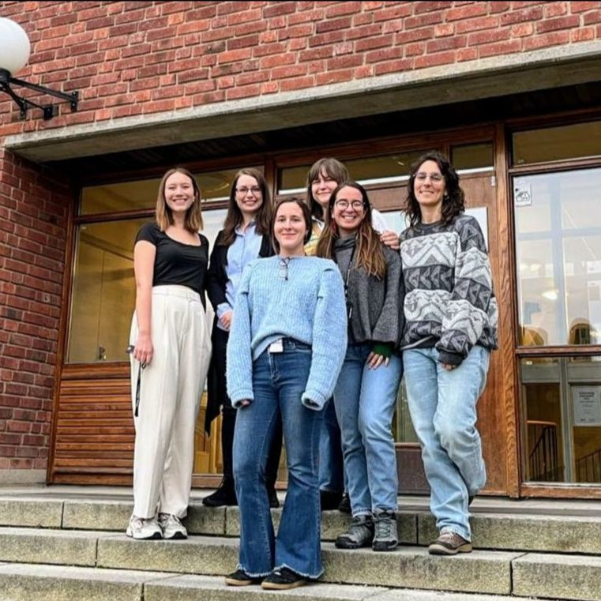
Marta Garrigós from Spain went to visit Dr. Ellin Videvall in  Sweden, to analyze data of the microbiome of Culex pipiens mosquitoes exposed and unexposed to Plasmodium relictum. 

An anecdote?

> "I had the opportunity to attend a Swedish thesis defense. The PhD students made a theater parody of the person defending the thesis and the different people in the department, and I found it funny."
   

### Misa Shimizu 

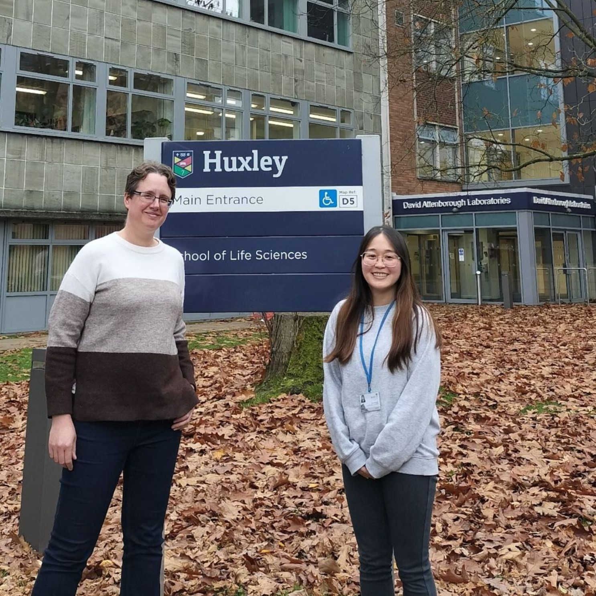
Misa Schimizu from Lithuania visited Dr. Jenny Dunn, in the UK to conduct morphological and molecular identification of Haemoproteus in vultures. 

An anecdote?

> "I identified Haemoproteus parasites from vultures morphologically for the first time. STSM was also a nice opportunity to talk with researchers and students having different backgrounds at Keele University."
   

### Irène Hernández Caballero 

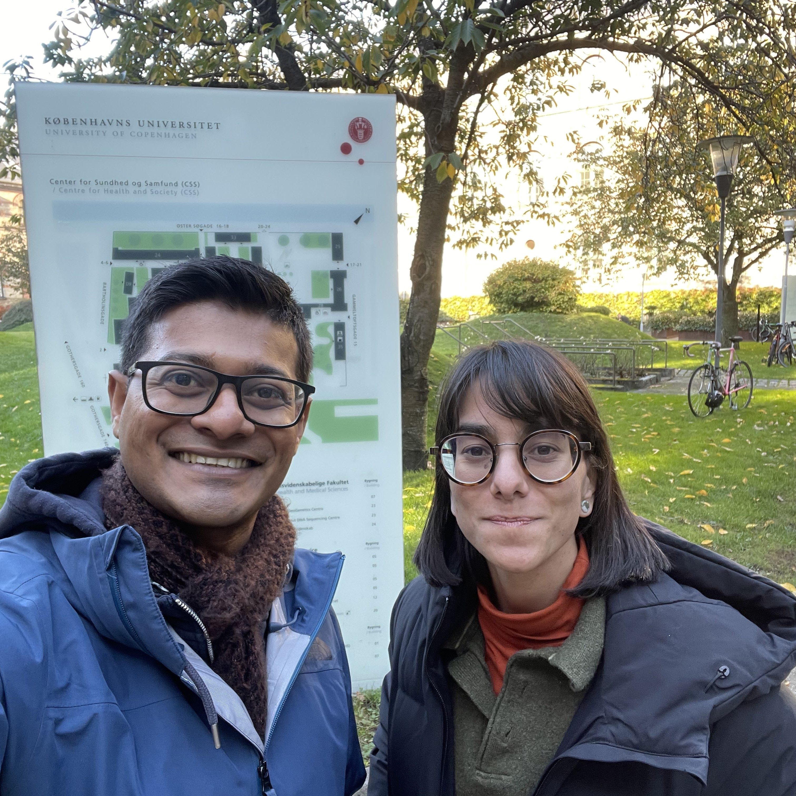
Irène Hernández Caballero from Spain went to visit Dr. Kasun Bodawatta in Denmark to analyze uropygialmicrobiome samples from house sparrows infected with avian malaria. 

An anecdote?

> "Dr. Bodawatta was very welcoming and thoughtful. One of the most memorable moments was when he brought me a croissant as a welcome gift, as I had told him I love pastries. I thought it was a very nice gesture and the best welcome. I also had the pleasure of attending a lab meeting and spending a few days doing field work with his group, which was a very valuable experience."
   

### Luca Ilahiane

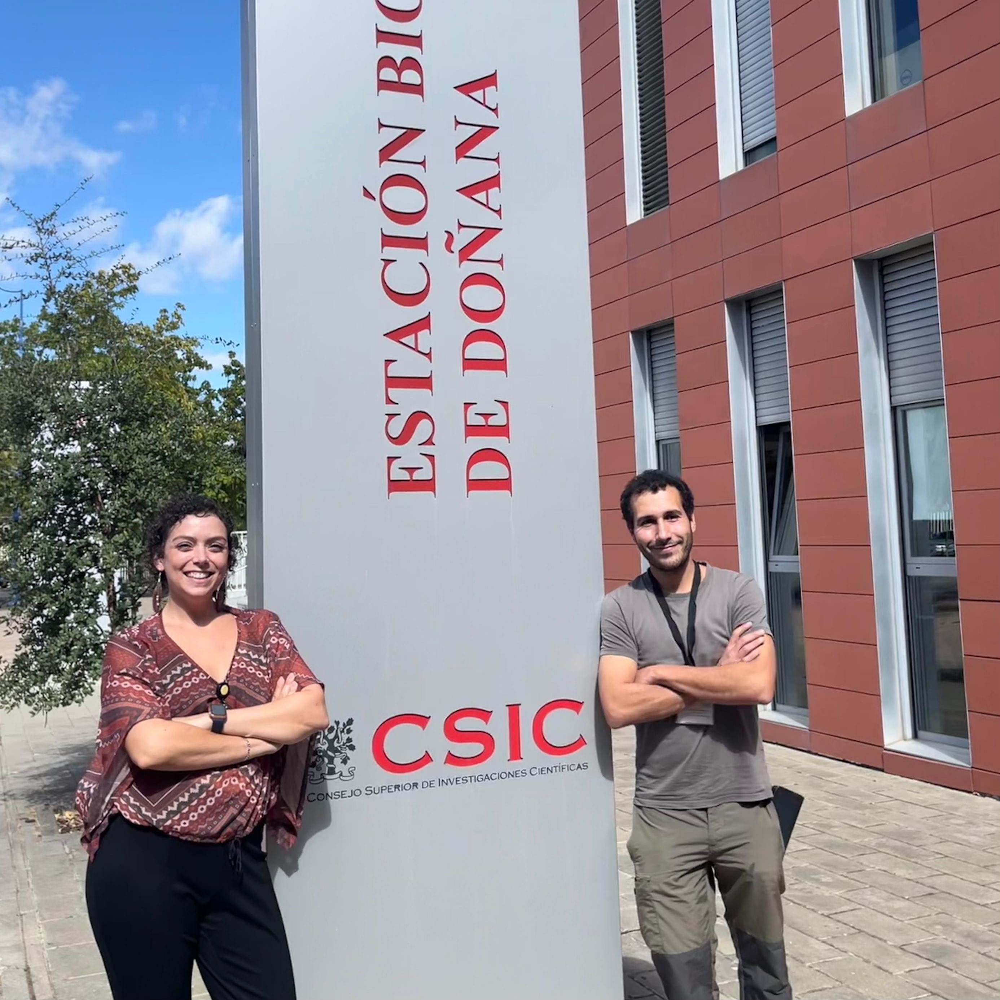
Luca Ilahiane from Italy, went to visit Dr. Martina Ferraguti in Spain to perform sample screening for parasite occurrence in avian samples, collected as part of a broader study investigating the effects of urbanization on synanthropic and near-endemic species. 

Your expectations?

> "In just one month of stay, all 388 samples were fully screened for all parasites, and the infected ones were sequenced. This provided interesting new data on host-parasite relationships in heavily urbanized environments."
   

### Attila Sándor

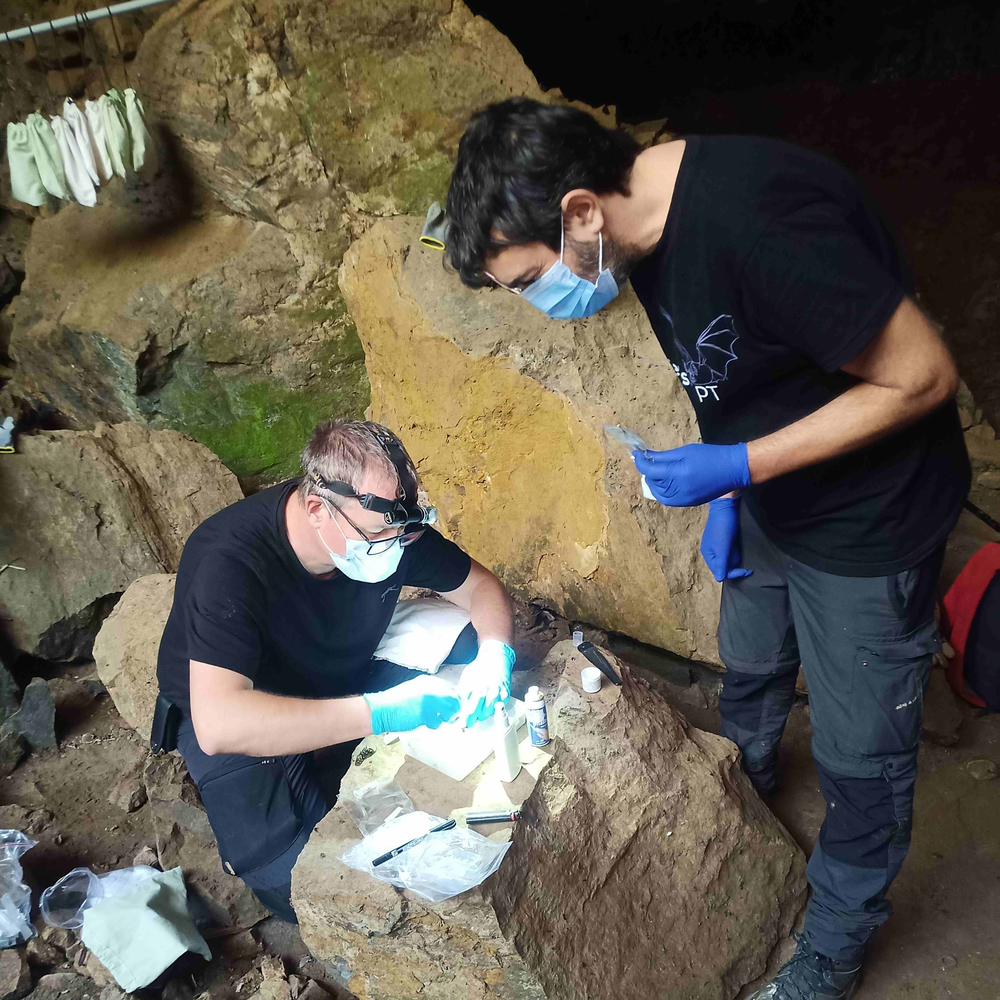
Attila Sándor from Hungary went to visit the Bat Ecology Group of the Centre for Ecology, Evolution and Environmental Changes at the University of Lisbon, Portugal, to bridge research methodology and practical knowledge between two teams of bat researchers in order to set up a joint study in bat-malaria. 

Your expectations?

> "The results of the STSM are the jointly approved and enhanced set of highly standardized procedures for simultaneous data collection for the impact of hibernation (or lack of hibernation) on malaria-clearance in bent-winged bats, which will constitute the base for an experimental study in the near future. The techniques were tested and repeated in three successive setting at three different bent-winged bat colonies in N, C and SE Portugal (Tamar/Nabao, Mira Moura and Montemor-o-Novo), both at natural (caves), as well anthropogenic roosts (mine shafts). The participants from Portugal (2 persons from the University and 3 persons from local groups at Porto and Montemor) were familiarized with techniques of bat capture as well blood and ectoparasite collection intended for malaria surveys."
   

### Alexandra Corduneanu

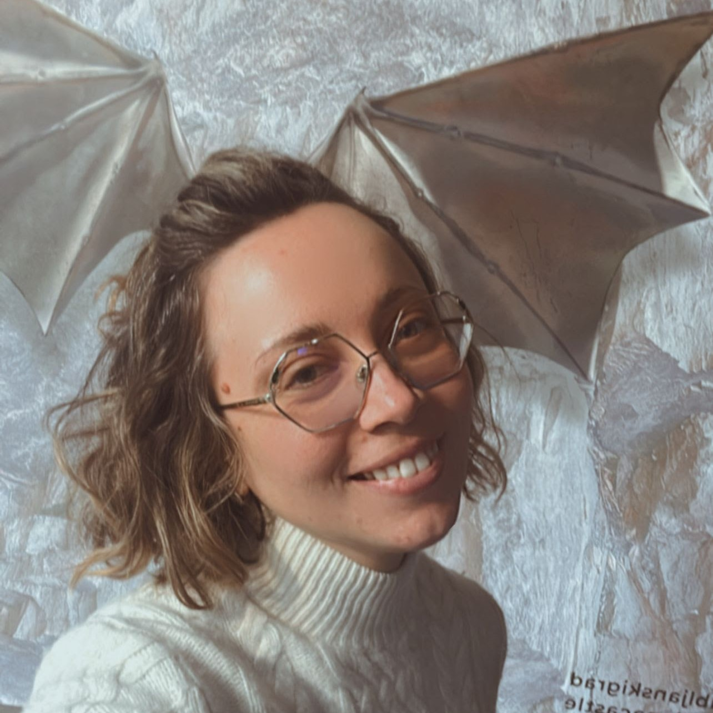
Alexandra Corduneanu from Romania visited Alejandro Cabezas-Cruz, PhD Principal Investigator UMR BIPAR (INRAE, Anses, EnvA), Paris, France to analyze the microbiome of bats associated with their parasites. The outcomes of this visit will contribute to a deeper understanding of bat-associated vector-borne pathogens in French Giana and Romania, aiding in the development of effective surveillance and management strategies. By elucidating the complex interactions between bats and their vector-borne pathogens, this study aimed to mitigate the risks posed by these diseases to both wildlife and human populations. 

An anecdote?

> "During my time at UMR-BIPAR ANSES in Paris, I spent countless hours in the lab carefully analyzing samples collected from bats. One afternoon, while discussing preliminary results with colleagues, we detected an unexpected pathogen appearing across multiple samples—one we hadn’t initially set out to find. Was this pathogen just an incidental finding, or was it playing a larger role in bat-vector interactions than we had anticipated? We are putting together all the information to identify if really is something new or not."
  
